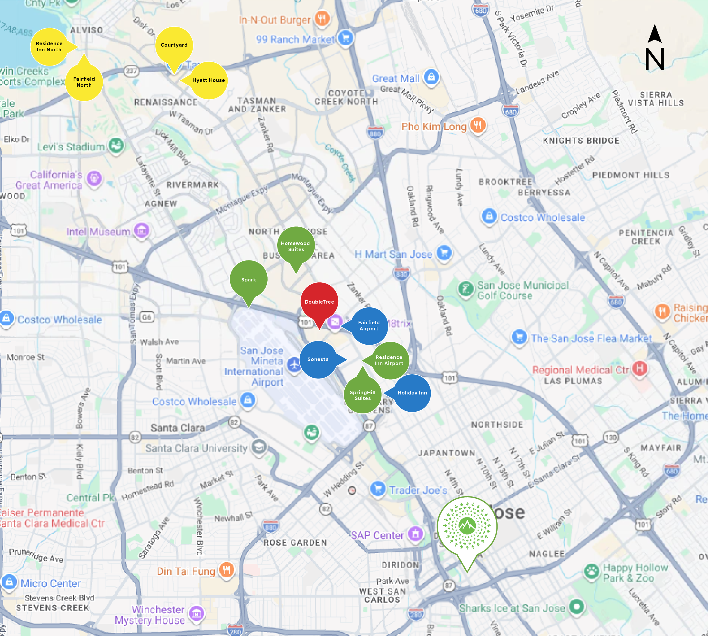

We’re excited to see you in San Jose for the 2026 OCP Global Summit! Here’s everything you need for the week, in the order you’ll need it.

## AT A GLANCE

| What                | Details                                                                                               |
| ------------------- | ----------------------------------------------------------------------------------------------------- |
| **Badge pickup**    | The Hub, near the main entrance of the San Jose McEnery Convention Center. **Bring a photo ID.**      |
| **Opening keynote** | Monday, Oct. 12 at 4:00 PM in South Hall. Pick up your badge early to avoid the line.                 |
| **Your badge**      | Wear it at all times to access Summit functions.                                                      |
| **Parking**         | Very limited, and the South Hall lot is closed this year. Use rideshare, transit, or a hotel shuttle. |
| **Registration**    | The Summit is sold out. There is no onsite registration.                                              |

## BEFORE YOU GO

### Getting there and parking

The convention center has very little public parking, and it fills up quickly. Unlike past years, **the South Hall parking lot will not be available** during the Summit. Please use rideshare, public transit, or one of the free hotel shuttles (see [Getting around](#getting-around) below). [Parking information](https://www.sanjose.org/trip-ideas/parking)

### Can’t make it? Transfer your ticket

* **Before the show:** you can transfer your ticket to someone else before your badge has been printed. Log in to the Summit Platform, open the **“My Orders/Tickets”** tab (top right of the navigation bar), select the ticket, and choose **“Reassign.”** Only the ticket purchaser can transfer a ticket.
* **During the show:** a limited onsite badge transfer option lets different staff attend on different days. <a href="https://www.opencompute.org/wp-content/uploads/2026/10/Onsite-Badge-Transfers-Public-Link-2.pdf" target="_blank" rel="noopener noreferrer">See the details and rules</a>.

## BADGE PICKUP

Badge pickup is in **The Hub**, near the main entrance of the convention center. **Bring a photo ID.**

| Day                    | Hours              |
| ---------------------- | ------------------ |
| **Monday, Oct. 12**    | 11:00 AM – 7:00 PM |
| **Tuesday, Oct. 13**   | 7:30 AM – 7:00 PM  |
| **Wednesday, Oct. 14** | 7:30 AM – 5:00 PM  |
| **Thursday, Oct. 15**  | 7:30 AM – 4:00 PM  |

> 💡 **Tip:** Lines are longest on Monday right before the 4:00 PM keynote. Pick up your badge early.

## KEYNOTES

Keynotes are in **South Hall**, behind the main convention center building. It’s a 3–5 minute walk from the main entrance.

| Day                  | Time               |
| -------------------- | ------------------ |
| **Monday, Oct. 12**  | 4:00 PM – 6:00 PM  |
| **Tuesday, Oct. 13** | 9:00 AM – 11:30 AM |

Need help getting there? The free ADA shuttle runs from the main entrance (San Carlos St.) to South Hall; see [Getting around](#getting-around).

<a href="https://2026ocpglobal.fnvirtual.app/map/" target="_blank" rel="noopener noreferrer">VIEW THE VENUE MAP</a>

## GETTING AROUND

OCP runs two free shuttles: an **ADA shuttle** around the venue and **hotel shuttles** to and from partner hotels.

<a href="https://2026ocpglobal.fnvirtual.app/map/" target="_blank" rel="noopener noreferrer">VIEW THE FULL VENUE MAP</a>

### ADA shuttle (around the venue)

| Day                    | Hours              |
| ---------------------- | ------------------ |
| **Monday, Oct. 12**    | 2:30 PM – 7:45 PM  |
| **Tuesday, Oct. 13**   | 7:30 AM – 12:00 PM |
| **Wednesday, Oct. 14** | 7:00 AM – 2:00 PM  |
| **Thursday, Oct. 15**  | 7:00 AM – 2:00 PM  |

**Stops** (numbers match the map above):

* **1.** San Carlos Street, near the main entrance (pick-up/drop-off)
* **2.** Viola Avenue at Market Street, by South Hall (pick-up/drop-off)
* **3.** Market Street, by the convention center entrance near the Marriott (drop-off only)
* **Hall 3 rear doors** (during Expo Hall hours): inside the Expo Hall, by the ramp on the west side of the dock behind Hall 3

### Hotel shuttles (hotels ⇄ convention center)

> ⚠️ **Arrive early.** No reservation is needed, but seats are limited. If a shuttle is full, wait for the next one. Shuttles loop continuously during the hours below.

**1. Find your hotel’s color**

| Color         | Hotels                                                                                                      |
| ------------- | ----------------------------------------------------------------------------------------------------------- |
| **🔴 Red**    | DoubleTree                                                                                                  |
| **🔵 Blue**   | Fairfield Airport Sonesta *(wait at Fairfield Airport)* Holiday Inn                                 |
| **🟢 Green**  | Homewood Suites Spark Residence Inn Airport SpringHill Suites *(wait at Residence Inn Airport)* |
| **🟡 Yellow** | Residence Inn North Fairfield North *(wait at Residence Inn North)* Courtyard Hyatt House       |

**2. Check the times**

| When                                                                      | Hours                                    |
| ------------------------------------------------------------------------- | ---------------------------------------- |
| **Monday, Oct. 12** · Hotel → Convention Center                           | 2:00 PM – 7:00 PM *(about every 30 min)* |
| **Monday, Oct. 12** · Convention Center → Hotel                           | 2:00 PM – 7:00 PM *(about every 30 min)* |
| **Tuesday, Oct. 13** & **Wednesday, Oct. 14** · Hotel → Convention Center | 7:00 AM – 11:00 AM                       |
| **Tuesday, Oct. 13** & **Wednesday, Oct. 14** · Convention Center → Hotel | 3:30 PM – 7:30 PM                        |
| **Thursday, Oct. 15** · Hotel → Convention Center                         | 7:00 AM – 11:00 AM                       |
| **Thursday, Oct. 15** · Convention Center → Hotel                         | 1:00 PM – 5:00 PM *(fewer shuttles)*     |

**3. Board your shuttle**

* **Mornings:** wait in front of your hotel and look for the sign in your color.
* **Afternoons:** go to the convention center pickup spot on **South Almaden Blvd. (Hilton side)** and look for the sign in your color.
* **Ride time:** 10–35 minutes.

**Plan ahead:**

* **Monday:** the opening keynote starts at **4:00 PM**, and shuttles will be extra busy beforehand. Leave your hotel early.
* **Thursday:** final day, with fewer shuttles. Leave extra time if you need your luggage.
* **In a hurry?** Use a rideshare or taxi.

  

## DURING THE SUMMIT

* **Your badge gets you in.** Wear it at all times to access Summit functions. Thank you for your cooperation!
* **What’s included:** all sessions (Keynotes, Executive and Breakout, and the Expo Hall Theater), the Expo Hall, Innovation Village, breakfast, lunch, coffee and snack breaks, evening receptions, the Future Technologies Symposium, and all official co-located events.
* **Need a break?** The parks in the Expo Hall are a great place to chat, check email, network, or recharge between sessions.
* **Need a small meeting space?** Book a four-person OCP Meeting Pod [here](https://book.zenspace.io/ocp/global-summit-2026/).
  Meeting pods are located in the West Lobby of the San Jose McEnery Convention Center on the Concourse Level (near the Hilton).
  Cost: $500 (USD) for two hours.
* **Get More from OCP Membership:** Interested in Membership? [Click here](https://community.opencompute.org/web/#/flowlink/JNFueMO) to unlock your benefits and help shape what's next.

### Schedule

View the full [Summit schedule](/a/schedule/).

## AFTER THE SUMMIT

* **Missed a session?** All sessions will be recorded. Video and slides will be posted to the [OCP Past Events page](https://www.opencompute.org/events/past-events) in the days following the Summit.
* **Staying a few extra days?** See <a href="https://www.sanjose.org/things-to-do" target="_blank" rel="noopener noreferrer">things to do in San Jose</a>.
